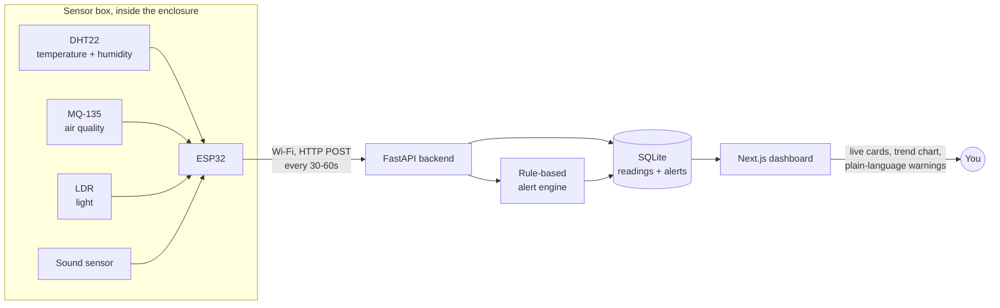

<div align="center">

# 🪺 NestGuard

**Live sensor monitoring for beehives, chicken coops, and small livestock enclosures**

</div>

---

## Problem

Beekeepers and small poultry farmers can't watch their hives or coops all day. If it gets too
hot, too humid, or the air turns bad inside, the bees or birds can get sick or die, and by the
time someone notices on a manual check, it's often too late. There's no easy, cheap way for a
small farmer to know what's happening inside the box right now.

## Solution

A small ESP32-based sensor box sits inside the enclosure, constantly reading temperature,
humidity, air quality, light, and sound, and sends this data over Wi-Fi to a locally-hosted
dashboard. The dashboard shows live readings, trend charts, and a plain-language warning the
moment something crosses a safe threshold (e.g. *"Temperature critically high. Act now"*). No manual checking needed, no cloud hosting
required.

## How it works



Everything runs on one local network: no internet dependency, no cloud bill. Your laptop hosts
the backend and dashboard. Boxes are plug and play: Wi-Fi is set from a phone through the box's
own setup hotspot, and the box finds whichever laptop runs NestGuard by UDP broadcast
(`backend/app/discovery.py`), so no IP is ever typed in and any laptop works.

## Features

- **Three boxes, one per animal.** A beehive (`HIVE1`), a chicken coop (`COOP1`) and a livestock
  shelter (`SHED1`). Each has its own panel on the overview: live temperature, humidity and air
  quality, a 24h sparkline, and a plain-language verdict.
- **Safe ranges per animal.** Every reading sits on a gauge split into safe, watch and danger
  zones for that animal. 35°C is a normal brood nest for bees but dangerous for chickens, so
  the limits differ (table below).
- **Automatic alerts.** When a reading leaves its safe range an alert opens; when the status
  changes or recovers, it closes. The alert log on the overview and each box's page keeps the
  full history.
- **Register a box from the dashboard.** Pick the box from a dropdown; the form shows the exact
  `ENCLOSURE_ID` line to flash into the firmware.
- **Offline detection.** A box that misses a few check-ins (5 min) is flagged as offline.
- **No fake data.** A box shows readings only once a real ESP32 posts, or while the simulation
  runs. Until then it shows zeros and "waiting for first reading".
- **Live refresh.** The dashboard refreshes itself every 15 seconds, every 2.5 seconds while a
  simulation runs.

### Safe ranges

| Box | Watch from | Danger from | Why |
|---|---|---|---|
| Beehive | 37°C | 39°C | Bees hold the brood nest at 34 to 36°C; brood is damaged above ~37°C |
| Chicken coop | 30°C | 35°C | Chickens can't sweat and start panting above ~30°C |
| Livestock shelter | 28°C | 32°C | Rabbits and similar animals overheat quickly |
| All boxes, air quality | 1800 | 2600 | Raw MQ-135 reading; calibrate on site |

Limits live in `backend/app/devices.py`.

### No hardware? Run the simulation

Press **Run simulation** in the top bar. A virtual ESP32 posts readings for every registered box
through the same ingestion endpoint a real box uses, every 3 seconds for 2 minutes:

1. Baseline, everything in range.
2. The coop heats up past 30°C (watch), then past 35°C (act now).
3. The coop cools down while the hive's air goes stale.
4. The hive vent clears and everything returns to normal.

The hive stays at ~35°C the whole time and stays green, which shows the per-animal limits at
work. Alerts open and close live in the alert log.

Simulated data only exists while the run is on. Starting, finishing or stopping a run wipes all
readings and alerts and puts every box back to "waiting for first reading". Don't run it once real
boxes are installed.

## Hardware

One small box per enclosure. Total cost is roughly ₹1,000–1,300. The
[hardware guide](docs/HARDWARE_GUIDE.md) has the exact shopping list (including the three resistors
the MQ-135 needs) and wiring.

| Part | What it does | Cost (₹) |
|---|---|---|
| ESP32 dev board | Reads all sensors, sends data over Wi-Fi | 350–450 |
| DHT22 sensor | Temperature and humidity | 180–250 |
| MQ-135 sensor | Air quality (detects gas/ammonia buildup) | 120–150 |
| LDR (light sensor) | Detects if the box/lid has been opened, day/night | 20–30 |
| Sound sensor | Unusual noise level (buzzing, distress) | 40–60 |
| Wires + small breadboard | Connects everything together | 100–150 |
| Small protective box | Keeps electronics safe from dust/moisture | 100–150 |
| Power adapter/cable | Powers the whole thing | ~100 |

**Optional add-ons** (not built yet, only worth it once the core system is proven):

| Part | What it does | Cost (₹) |
|---|---|---|
| Weight sensor (HX711 + load cell) | Tracks hive weight over time | 250–350 |
| Relay + small fan | Auto-ventilation instead of just a warning | 150–200 |

## Tech stack

| Layer | Tech |
|---|---|
| Firmware | ESP32 (Arduino/C++), DHT, ArduinoJson and WiFiManager libraries |
| Backend | FastAPI, SQLAlchemy, SQLite |
| Frontend | Next.js 14 (App Router), TypeScript, Tailwind CSS, Recharts |

## Quick start

**Windows, one step:** double-click `setup.bat` (or run it from a terminal). It installs Python
and Node.js via winget if missing, sets up the backend venv and npm packages, creates the `.env`
files, seeds the database, and opens the dashboard. After that, start the app any time with
`run.bat`. `setup.bat --install-only` sets up without starting the servers.

**macOS, one step:** in Terminal, run `bash setup.sh`. It does the same as `setup.bat` (installs
Python 3.12 and Node.js via Homebrew if missing, or tells you where to get them). After that,
start the app with `bash run.sh`; both servers run in that Terminal window, Ctrl+C stops them, and
it keeps the Mac awake while running. macOS may ask once to allow incoming / local network
connections: allow them so the boxes can reach the Mac.

**Manual setup** requires Node.js 18+ and Python 3.11+.

**1 · Backend**

```bash
cd backend
python -m venv venv
venv\Scripts\activate        # Windows; on macOS/Linux: source venv/bin/activate
pip install -r requirements.txt
copy .env.example .env       # `cp` on macOS/Linux. Defaults work as-is
python -m app.seed           # creates honeychain.db, registers HIVE1 + COOP1 (--reset to start over)
uvicorn app.main:app --reload --host 0.0.0.0 --port 8000   # 0.0.0.0 so ESP32 boxes on Wi-Fi can reach it
```

**2 · Frontend**, in a second terminal

```bash
npm install
copy .env.local.example .env.local   # `cp` on macOS/Linux. Defaults work as-is
npm run dev
```

Open **http://localhost:3000**. Backend API docs: **http://localhost:8000/docs**.

**3 · Hardware**: follow the step-by-step [hardware guide](docs/HARDWARE_GUIDE.md) (shopping list,
wiring, flashing, placement, troubleshooting). Short version:

Set the box's `ENCLOSURE_ID` (`HIVE1`, `COOP1` or `SHED1`) at the top of the sketch and flash it
(libraries: DHT sensor library, ArduinoJson 7, WiFiManager by tzapu). Power it, join its
`NestGuard-<ID>` hotspot from a phone and pick your Wi-Fi. It then finds the laptop running
`run.bat` / `run.sh` and its readings appear on the dashboard. `setup.bat` opens the Windows firewall for this
(TCP 8000/3000, UDP 47800, local subnet only) after one admin prompt.

**Security.** Writes need the shared `API_KEY`. Boxes only trust a discovery answer carrying an
HMAC proof made with that key, and the dashboard's proxy routes refuse requests that don't come
from the dashboard itself (CSRF). The default key `dev-local-key` is public, so for anything
beyond a home demo set your own in all three places: `backend/.env` (`API_KEY`), `.env.local`
(`HONEYCHAIN_API_KEY`) and the firmware (`API_KEY`).

### Tests

```bash
cd backend && python -m pytest
```

## Project structure

```
app/
  enclosure/                 Overview, box detail page, register form
  api/                       Server-side proxies that attach the API key (register, simulation)
components/                  Panels, safe-range gauge, charts, alert log, top bar
lib/                         API client, types, display helpers
backend/
  app/devices.py             The three boxes and their per-animal limits
  app/insight.py             Rule-based verdict from readings and limits
  app/services.py            Reading ingestion and alert open/close logic
  app/simulation.py          Virtual ESP32 scenario
  app/discovery.py           Answers box discovery broadcasts (UDP 47800)
  app/routers/               Enclosures, devices + alert feed, simulation
  app/seed.py                Registers HIVE1 + COOP1 (python -m app.seed [--reset])
firmware/nestguard/          ESP32 Arduino sketch (Wi-Fi setup hotspot + laptop discovery)
docs/HARDWARE_GUIDE.md       Step-by-step build and setup guide, no experience needed
scripts/allow-firewall.bat   Firewall rule for the boxes (setup.bat runs it)
setup.bat / run.bat          One-time setup / start the app (Windows)
setup.sh / run.sh            Same for macOS (bash setup.sh, then bash run.sh)
```

## Status

The software pipeline (ingestion → storage → live dashboard → alerts) and box discovery are
built and tested, with simulated sensor data standing in for the boxes. The firmware has not yet
been flashed onto a real ESP32: build one box first, following the
[hardware guide](docs/HARDWARE_GUIDE.md), before building the rest.
