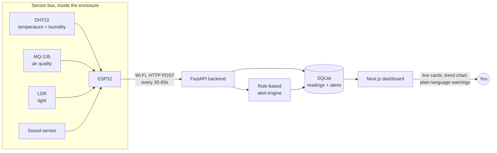

<div align="center">

# 🪺 NestGuard

**Live sensor monitoring for beehives, chicken coops, and small livestock enclosures**

</div>

---

## Problem

Beekeepers and small poultry farmers can't watch their hives or coops all day. If it gets too
hot, too humid, or the air turns bad inside, the bees or birds can get sick or die — and by the
time someone notices on a manual check, it's often too late. There's no easy, cheap way for a
small farmer to know what's happening inside the box right now.

## Solution

A small ESP32-based sensor box sits inside the enclosure, constantly reading temperature,
humidity, air quality, light, and sound, and sends this data over Wi-Fi to a locally-hosted
dashboard. The dashboard shows live readings, trend charts, and a plain-language warning the
moment something crosses a safe threshold (e.g. *"Temperature critically high — inspect
immediately"*) — no manual checking needed, no cloud hosting required.

## How it works



Everything runs on one local network — no internet dependency, no cloud bill. Your laptop hosts
the backend and dashboard; the ESP32 just needs to join the same Wi-Fi and knows your laptop's
local IP.

## Features

- **Live dashboard** — every registered enclosure shown as a card with current temperature,
  humidity, and air quality at a glance
- **Per-enclosure detail view** — all 5 sensor readings, a temperature/humidity trend chart, and
  a plain-language AI insight panel
- **Automatic alerts** — when a reading crosses a safe threshold, an alert opens; when it recovers,
  the alert auto-resolves. Full alert history is kept, not just the current state
- **Register enclosures from the dashboard** — no code changes needed to add a new hive/coop/
  shelter, just a name and an ID that the ESP32 firmware uses to identify itself
- **Offline detection** — if a device stops reporting, the dashboard flags it automatically after
  a few missed check-ins

## Hardware

One small box per enclosure. Total cost is roughly ₹1,000–1,300.

| Part | What it does | Cost (₹) |
|---|---|---|
| ESP32 dev board | Reads all sensors, sends data over Wi-Fi | 350–450 |
| DHT22 sensor | Temperature and humidity | 180–250 |
| MQ-135 sensor | Air quality (detects gas/ammonia buildup) | 120–150 |
| LDR (light sensor) | Detects if the box/lid has been opened, day/night | 20–30 |
| Sound sensor | Unusual noise level (buzzing, distress) | 40–60 |
| Wires + small breadboard | Connects everything together | 100–150 |
| Small protective box | Keeps electronics safe from dust/moisture | 100–150 |
| Power adapter/cable | Powers the whole thing | ~100 |

**Optional add-ons** (not built yet — only worth it once the core system is proven):

| Part | What it does | Cost (₹) |
|---|---|---|
| Weight sensor (HX711 + load cell) | Tracks hive weight over time | 250–350 |
| Relay + small fan | Auto-ventilation instead of just a warning | 150–200 |

## Tech stack

| Layer | Tech |
|---|---|
| Firmware | ESP32 (Arduino/C++), DHT + ArduinoJson libraries |
| Backend | FastAPI, SQLAlchemy, SQLite |
| Frontend | Next.js 14 (App Router), TypeScript, Tailwind CSS, Recharts |

## Quick start

Requires Node.js 18+ and Python 3.11+.

**1 · Backend**

```bash
cd backend
python -m venv venv
venv\Scripts\activate        # Windows — `source venv/bin/activate` on macOS/Linux
pip install -r requirements.txt
copy .env.example .env       # `cp` on macOS/Linux — defaults work as-is
python -m app.seed           # creates honeychain.db with sample enclosures
uvicorn app.main:app --reload --port 8000
```

**2 · Frontend**, in a second terminal

```bash
npm install
copy .env.local.example .env.local   # `cp` on macOS/Linux — defaults work as-is
npm run dev
```

Open **http://localhost:3000**. Backend API docs: **http://localhost:8000/docs**.

**3 · Firmware** (once you have the hardware — see `firmware/nestguard/nestguard.ino`)

Edit the Wi-Fi credentials, your laptop's local IP, and the enclosure ID at the top of the sketch,
flash it to the ESP32, and its readings will start appearing on the dashboard automatically.

### Tests

```bash
cd backend && python -m pytest
```

## Project structure

```
app/                         Next.js pages
  enclosure/                 Dashboard list, detail view, registration form
  api/enclosures/            Server-side proxy for the one client-side write
backend/
  app/models.py              Enclosure, SensorReading, Alert
  app/routers/enclosures.py  List/create enclosures, ingest readings, list alerts
  app/insight.py             Rule-based threshold logic (temperature, air quality)
firmware/nestguard/          ESP32 Arduino sketch
report.md                    Full written explanation of the project
```

## Status

The software pipeline (firmware code → ingestion → storage → live dashboard → alerts) is built
and tested end to end with simulated sensor data. Physical hardware hasn't been wired up yet —
see `report.md` for what's next.
